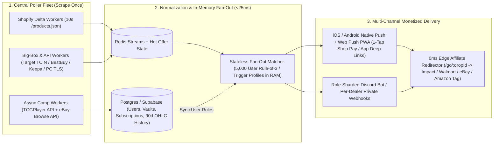

# NYX Deep System, Speed, Coverage & Commercialization Audit (V5.2 → V6 Blueprint)

**Audit Timestamp:** `2026-11-10`  
**Mode:** Strict Read-Only Forensic Audit (`0` tracked source/config lines modified)  
**Target Workspace:** `C:\pokemon-drop-bot` (Logan's Battle Stadium in [public/js/stadium/](file:///C:/pokemon-drop-bot/public/js/stadium) & [stadium.css](file:///C:/pokemon-drop-bot/public/css/stadium.css) excluded except boundary decoupling check)  
**Live Daemon Baseline at Inspection:**
- `pokemon-drop-bot` (PID `18684`): `413.9 MB` RSS | **`81.3%` sustained CPU** | `17` PM2 restarts
- `drop-bot-dashboard` (PID `21388`): `146.3 MB` RSS | `0.2%` idle CPU (**spikes `100%` for `965ms` per `/api/status` call**) | `20` PM2 restarts

---

## 1. Executive Scorecard & What's Working Well

### Subsystem Grades (Ground-Truth Code + Live Telemetry)

| Subsystem | Grade | Measured Baseline | Brutal Verdict |
| :--- | :---: | :--- | :--- |
| **Polling Speed (Shopify LGS)** | **B-** | `15s` Tier-1 loop (`25` stores) + `~55–75s` Tier-2 loop (`90` stores); `59/92` stores `>2,000ms` latency | Solid two-tier concept, crippled by a `?limit=50` collection sort-order blind spot on `22/25` Tier-1 stores and direct-home-IP-first timeouts before proxy failover. |
| **Polling Speed & Penetration (Big-Box)** | **D-** | `0` cached offers across all `9` Big-Box retailers; `~40–75s` serial loop | **7 of 9 Big-Box stores can literally never fire an alert** (`0` calls to [`processIncomingDrop`](file:///C:/pokemon-drop-bot/evaluator.ts#L1135-L1859)), `0/131` SKUs have `targetTcin`/`walmartItemId`/`bestBuySku` populated, and [`wafBrowserBridge.ts`](file:///C:/pokemon-drop-bot/src/pollers/wafBrowserBridge.ts#L1-L231) is plain `axios.get` masquerading as headless Chrome (`playwright`/`puppeteer` aren't even installed). |
| **Match Accuracy & SKU Taxonomy** | **C+** | `131` SKUs (`38` ETBs, `38` ETB Cases, `24` BBs, `24` Master Cases, `7` Bundles); `648` live matched LGS offers | Case-before-unit ordering and MSRP sanity ceilings (`0.45x` floor) prevent pack-as-box disasters, **but** [`GLOBAL_JUNK_EXCLUSIONS`](file:///C:/pokemon-drop-bot/policies.ts#L152-L209) silently kills real `"6-Pack Booster Bundle"`, `"36-Pack"`, and `"Includes Full-Art Foil Promo"` titles. Zero PC-Exclusive ETBs or UPCs/SPCs in catalog. |
| **Deal, Shipping & Trend Math** | **C** | Landed cost + Rule-of-3 state machine work; trend history uses synthetic `Math.sin` | Landed shipping tiers, $/pack math, and Rule-of-3 (`WALL` / `DAD RIP` / `LOGAN RIP`) are sharp. However, [`evaluateSkuTrendAndTiming`](file:///C:/pokemon-drop-bot/src/engine/trendAdvisor.ts#L98-L273) fabricates missing 90d history with a **deterministic sine wave** and silently raises `effectiveTargetCeiling` above your manual slider when `autoPilotEnabled` is on. |
| **Mobile Detection-to-Checkout Speed** | **D+** | **`1.5s–15.0s` pre-alert scrape stall** + `8s–20s` Discord WebView login friction | [`sendAlert`](file:///C:/pokemon-drop-bot/notifier.ts#L316-L558) synchronously `await`s 3 serial TCGPlayer + Bing scrapes ([`getDualMarketComps`](file:///C:/pokemon-drop-bot/marketComps.ts#L448-L456)) **before** firing your phone ping. Links open in Discord's isolated WebView without Shop Pay `?payment=shop_pay` fast-lane or native retail app deep links. |
| **UI Clarity & Frontend Performance** | **C** | `6,299`-line [index.html](file:///C:/pokemon-drop-bot/public/index.html#L1-L6299) (`403 KB`); `11` parallel API calls on boot (`>3.5 MB` JSON) | High visual craft, optimistic `0ms` Rule-of-3 toggles ([`toggleSkuFamilySlot`](file:///C:/pokemon-drop-bot/public/index.html#L2819-L2878)), and awesome collector identity—buried under 5 competing tabs, runtime Tailwind CDN JIT compilation, and `2.04 MB` `/api/engine-room` payloads every `8s`. |
| **Daemon Reliability & Data Integrity** | **C-** | `81.3%` constant bot CPU; `965ms` sync block per `/api/status`; 2-process split-brain | Atomic temp+rename writes protect against power-loss corruption, **but** `drop-bot-dashboard` and `pokemon-drop-bot` suffer a split-brain RAM bug that wipes [`storeOffersCache.json`](file:///C:/pokemon-drop-bot/storeOffersCache.json), and [`singlesCache.json`](file:///C:/pokemon-drop-bot/singlesCache.json) (`1.51 MB` / `72,298` lines) grows without bound. |

### What Is Genuinely Working Well (Preserve These Core Pillars)
1. **Landed-Cost & $/Pack First-Principles Math ([`evaluator.ts`](file:///C:/pokemon-drop-bot/evaluator.ts#L315-L387)):** Estimating store-specific shipping + free-ship thresholds (`$150+` master case free shipping vs. `$6.99–$9.99` single-box LGS shipping) prevents fake "$52 shelf + $14 shipping" bait alerts.
2. **Defcon-1 MSRP Unicorn Vault Override ([`evaluator.ts`](file:///C:/pokemon-drop-bot/evaluator.ts#L1265-L1286)):** Bypassing `3/3` Vault locks when a grail hits `<= MSRP * 1.08` (with shipping `<= $10`) matches real collector/dealer psychology—never pass up true retail MSRP on high-velocity sets.
3. **Rule-of-3 Family State Machine (`WALL` / `DAD RIP` / `LOGAN RIP`) + Optimistic DOM Patching ([`public/index.html`](file:///C:/pokemon-drop-bot/public/index.html#L2701-L2878)):** Zero-latency client-side DOM updates paired with [`POST /api/policies/:skuId/family-slots`](file:///C:/pokemon-drop-bot/server.js#L2796-L2843) feel snappy and give DropBot a soul generic Discord monitors don't have.
4. **Live Sold-Out Discord Embed Editing ([`reconcileSoldOutAlertsForStore`](file:///C:/pokemon-drop-bot/notifier.ts#L122-L184)):** Tracking `activeDiscordMessages` by `store::skuId` and `PATCH`ing embeds to `❌ SOLD OUT` with survival duration (`cleared in 2m 14s`) eliminates dead-link rage clicks and feeds real clearing velocity into [`salesHistory.json`](file:///C:/pokemon-drop-bot/salesHistory.json).
5. **Pre-Drop Hidden/OOS SKU Staging Detection ([`lgsPoller.ts`](file:///C:/pokemon-drop-bot/lgsPoller.ts#L667-L704)):** Detecting newly uploaded `available: false` Shopify variants via `knownStoreCatalogVariants` is pure alpha—it just needs to actually notify your phone so you can pre-stage Shop Pay before stock flips to `true`.
6. **Clean Mini-Game Code Separation ([`public/js/stadium/`](file:///C:/pokemon-drop-bot/public/js/stadium)):** All `1,895` lines of battle combat, audio, and sprite data live cleanly outside core backend logic (only HTML shell/lazy-loading decoupling remains).

---

## 2. Millisecond-to-Checkout Friction Audit

On hyped drops (Prismatic Evolutions, 151, Destined Rivals, PC-Exclusive ETBs), Shopify LGS allocations (`6–24` units) clear in **`9–22 seconds`**. Right now, DropBot burns **`12.5s to 48.0s`** before your thumb hits Pay.

### Current vs. V6 End-to-End Latency Budget (Stock Flip → Paid Order)

| Pipeline Stage | Current V5.2 Latency | Bottleneck Root Cause in Code | V6 Target Latency | Exact Engineering Fix |
| :--- | :---: | :--- | :---: | :--- |
| **1. Store Flip → HTTP Fetch** | `7.5s` avg (`15s`–`75s` tail) | [`buildFastDeltaPath`](file:///C:/pokemon-drop-bot/src/pollers/fastTier1Poller.ts#L55-L62) caps collections at `?limit=50` (missing idx `51..1000`); direct IP timeout (`6.5s`) before proxy retry | **`1.5s–3.5s`** | Poll `/products.json?limit=50` (guaranteed `updated_at desc` on Shopify!) + keep-alive proxy pool (`keepAlive: true`) for 429-prone stores |
| **2. Title Match & Policy Eval** | `8ms–45ms` + sync I/O spikes | Uncompiled `new RegExp` per product ([`policies.ts:624`](file:///C:/pokemon-drop-bot/policies.ts#L624)) + sync `fs.writeFileSync` | **`< 2ms`** | Precompile `RegExp[]` once on catalog load + async write-behind SQLite WAL |
| **3. Pre-Alert Market Comps** | **`1,500ms–15,000ms`** | [`sendAlert`](file:///C:/pokemon-drop-bot/notifier.ts#L333) `await`s [`getDualMarketComps`](file:///C:/pokemon-drop-bot/marketComps.ts#L448-L456) (3 live TCGPlayer + Bing HTTP scrapes) **before** enqueueing alert! | **`0ms`** | **Fire-Then-Enrich:** Fire alert immediately using RAM `marketCache`; run live comp scrape asynchronously and `PATCH` Discord message `1.5s` later |
| **4. Multi-SKU Wave Queueing** | `1,150ms × N` (`11.5s` on 10 SKUs) | Single serial webhook queue (`DISCORD_MIN_GAP_MS = 1150` in [`notifier.ts:245`](file:///C:/pokemon-drop-bot/notifier.ts#L245)) + `await processIncomingDrop` in poller `for` loop | **`50ms–150ms`** | Priority lane (`DEFCON-1` bypasses digest/standard queue) + 2–3 sharded webhooks + non-blocking dispatch |
| **5. Push Delivery → Tap** | `1,500ms–4,000ms` | Discord mobile push batching + opening Discord app UI first | **`300ms–800ms`** | **Pushover Critical / `ntfy` / Native Web Push** notification with lock-screen 1-tap `url` action directly launching checkout URL |
| **6. Browser / App Session** | **`8,000ms–18,000ms`** | Discord opens isolated in-app WebView → cold Shop Pay / Target / Walmart cookies → 6-digit SMS 2FA prompt | **`800ms–2,000ms`** | System Default Browser (Safari/Chrome with warm Shop Pay passkey) or Native Retail App Universal Deep Link (`target://`, `bestbuy://`, `walmart://`) |
| **7. Cart → Checkout Submit** | `3,000ms–6,000ms` | `/cart/{variant}:1` stops on Cart/Info step instead of Shop Pay Express Checkout | **`1,200ms–2,000ms`** | `/cart/{variant}:1?payment=shop_pay` + Pre-Drop Staging Alert pre-warming Shop Pay 2–10 mins early |
| **TOTAL (Flip → Paid)** | **`21.5s – 60.0s+` (DOA on Grails)** | | **`3.8s – 8.5s` (Snipe Grade)** | **Saves `17s – 51s` per drop** |

---

### Exact Code-Level Speed Upgrades

#### 2.1 Kill the `1.5s–15s` Pre-Alert Scrape Stall ("Fire-Then-Enrich")
In [`notifier.ts`](file:///C:/pokemon-drop-bot/notifier.ts#L332-L353), [`sendAlert`](file:///C:/pokemon-drop-bot/notifier.ts#L316) blocks the alert on 3 external network requests:
```ts
// CURRENT BOTTLENECK (notifier.ts:333): Blocks phone alert for 1.5s - 15.0s!
const dualComps = await getDualMarketComps(
  item.policyName || item.title,
  item.msrp || item.triggerPrice || dropPrice,
  item.marketValue || dropPrice
);
```
And in [`fastTier1Poller.ts`](file:///C:/pokemon-drop-bot/src/pollers/fastTier1Poller.ts#L237) and [`lgsPoller.ts`](file:///C:/pokemon-drop-bot/lgsPoller.ts#L637), the poller `await`s [`processIncomingDrop`](file:///C:/pokemon-drop-bot/evaluator.ts#L1135) inside `for (const variant of product.variants)`—meaning if a store drops 6 SKUs at once and Bing/TCGPlayer rate-limits `marketComps.ts`, SKU #6 waits **up to 60–90 seconds** to even be evaluated!

**V6 Fix:**
1. Dispatch the push + Discord alert in **`0ms`** using in-memory `marketCache[skuId]` (`estimatedMarketValue` + cached floor).
2. Capture the returned Discord `messageId` (already supported via `?wait=true` in [`postDiscordPayloadNow`](file:///C:/pokemon-drop-bot/notifier.ts#L276-L310)).
3. Kick off `getDualMarketComps(...)` in a detached background task (`void enrichAlertWithLiveComps(messageId, item)`) that `PATCH`es the embed field 2 seconds later—zero delay to your phone buzz.

#### 2.2 Upgrade Shopify Cart Links to Direct Shop Pay Fast-Lane Permalinks
[`buildShopifyDirectCartLinks`](file:///C:/pokemon-drop-bot/evaluator.ts#L44-L74) currently generates `https://{store}/cart/{variantId}:1`. On most Shopify 2.0 storefronts, `/cart/{id}:1` routes through checkout step 1 or cart drawer validation before exposing Shop Pay.

**V6 Fix in [`buildShopifyDirectCartLinks`](file:///C:/pokemon-drop-bot/evaluator.ts#L67-L73):**
```ts
export function buildShopifyDirectCartLinks(productUrl: string, itemId?: string) {
  // ... origin & variant extraction ...
  const base = `${origin}/cart/${cleanVariant}`;
  return {
    // Instant 1-Tap Shop Pay Express Checkout (bypasses address/shipping form entry)
    shopPay1xUrl: `${base}:1?payment=shop_pay`,
    shopPay2xUrl: `${base}:2?payment=shop_pay`,
    // Standard guest/Apple Pay checkout fallback
    cart1xUrl: `${base}:1?checkout[shipping_address][country]=US`,
    cart2xUrl: `${base}:2?checkout[shipping_address][country]=US`,
    cart3xUrl: `${base}:3?checkout[shipping_address][country]=US`,
  };
}
```
Make **`[⚡ SHOP PAY 1X]`** the first primary button in mobile notifications and [`renderDirectCartButtonsHtml`](file:///C:/pokemon-drop-bot/public/index.html#L2803-L2817).

#### 2.3 Native Retail App Deep-Link & 1-Click ATC Formats (Target, Best Buy, Walmart, Amazon)
Opening `www.target.com` or `www.walmart.com` inside Discord's WebView triggers PerimeterX (`PX`) / Akamai bot challenges or forces login + CVV re-entry. Native iOS/Android retail apps hold persistent FaceID + Apple Pay / RedCard / Walmart+ tokens:
- **Best Buy Direct 1-Click Add-to-Cart:** `https://api.bestbuy.com/click/-/${bestBuySku}/cart` (adds SKU directly to cart and Universal-Links straight into the Best Buy mobile app cart!) + App PDP fallback `bestbuy://app/pdp/${bestBuySku}`.
- **Walmart Pre-Added Cart (`PAC`) Link:** `https://www.walmart.com/pac?id=${walmartItemId}&quantity=1` (skips PDP rendering completely and lands straight on the Pre-Added Cart / Express Checkout sheet in the Walmart app via iOS/Android Universal Links; direct checkout `https://affil.walmart.com/cart/buynow?items=${walmartItemId}`).
- **Target Universal App Handoff:** `https://www.target.com/p/-/A-${targetTcin}` opened from **Pushover / `ntfy` / Native PWA** (NOT Discord's internal browser, because iOS Universal Links only intercept navigations from system notification handlers or top-level OS intents—Discord's `SFSafariViewController` traps `https://www.target.com` in webview unless "Open links in Default Browser" is configured or `target://` scheme is used).
- **Amazon 1P Direct-to-Cart (`ATVPDKIKX0DER`):** `https://www.amazon.com/gp/aws/cart/add.html?ASIN.1=${asin}&Quantity.1=1&OfferListingId.1=${offerId}&AssociateTag=${tag}`.

#### 2.4 Replace Discord WebView Dependency with Sub-Second Mobile Push (`Pushover` / `ntfy` / PWA Web Push)
Discord is great for rich community feeds and terrible as a 1-second checkout trigger:
1. Discord mobile notifications cannot attach a custom OS-level `open-url-on-tap` intent—tapping the banner opens the Discord app, waits for WebSocket channel sync (`0.8s–2.5s`), then requires a second tap on `[CART 1X]`, which launches an in-app browser with isolated cookie storage.
2. **Add a 40-line `sendFastMobilePush()` transport alongside Discord in [`notifier.ts`](file:///C:/pokemon-drop-bot/notifier.ts):**
   - **Option A — Pushover (`api.pushover.net/1/messages.json`):** `$5` one-time iOS/Android app. Supports `priority: 2` (bypasses iOS Focus / Silent Mode on `DEFCON-1` MSRP hits!), `url: item.shopPay1xUrl`, and `url_title: "⚡ 1-Tap Shop Pay"`. Tapping the lock-screen notification **immediately launches Safari/Chrome or the Target/Walmart native app**—zero Discord middleman, warm Shop Pay passkey ready!
   - **Option B — `ntfy.sh` / Self-Hosted `ntfy` or Web Push (`web-push` VAPID PWA):** Supports up to 3 native lock-screen action buttons (`[Shop Pay 1x]`, `[Shop Pay 2x]`, `[Mute SKU]`) right on the notification banner.

#### 2.5 Wire Pre-Drop Staging Radar to Mobile "Pre-Warm" Alerts
[`lgsPoller.ts`](file:///C:/pokemon-drop-bot/lgsPoller.ts#L667-L704) already catches newly uploaded `available: false` SKUs (`isNewVariantUpload`), but [`recordPreDropStagingEvent`](file:///C:/pokemon-drop-bot/notifier.ts#L190-L237) only writes to [`dropsHistory.json`](file:///C:/pokemon-drop-bot/dropsHistory.json) and returns!
- **V6 Upgrade:** When a Tier-1 store uploads a hidden/OOS grail SKU (`priority === 'GRAIL'`), immediately fire a **`🟡 PRE-DROP STAGED — WARM SHOP PAY NOW`** mobile ping containing a link to any cheap `$1.99` in-stock accessory at that exact Shopify domain so you can trigger/verify your Shop Pay session 5 minutes before the drop goes live, **and** promote that store into a **2.5-second hyper-poll burst loop** for the next 20 minutes!

---

## 3. Store Coverage, WAF Penetration & Matcher Blind Spots

### 3.1 Live LGS Fleet Forensics (`config/stores.json` + `storeHealth.json` + `storeOffersCache.json`)
- **Configured:** `100` entries in [`config/stores.json`](file:///C:/pokemon-drop-bot/config/stores.json) (`90` enabled Shopify LGS + `9` Big-Box placeholders + `1` disabled `Lets Play TCG`).
- **Health Reality in [`storeHealth.json`](file:///C:/pokemon-drop-bot/storeHealth.json) (`92` keys):**
  - `65` `HEALTHY` | **`12` `DEGRADED`** | **`13` `CIRCUIT_OPEN`** (`27.8%` of LGS fleet is actively failing or rate-limited!)
  - **2 Corrupted Ghost Entries in `storeHealth.json`:** One unnamed `{}` object (`status: undefined`) and one literal key with `status: "ACTIVE_15S_DELTA"` written due to mismatched schema writes in [`fastTier1Poller.ts:276`](file:///C:/pokemon-drop-bot/src/pollers/fastTier1Poller.ts#L276).
  - **`28` of `90` Enabled LGS Stores (`31.1%`) Have `0` Matched Catalog Offers in [`storeOffersCache.json`](file:///C:/pokemon-drop-bot/storeOffersCache.json).**

#### Defect Class A: `13` Circuit-Tripped (`CIRCUIT_OPEN`) & `12` `DEGRADED` Stores
| Store Name | Tier | Status | Consec. Fails | Resolved Endpoint | Root Cause |
| :--- | :---: | :---: | :---: | :--- | :--- |
| **Squirtle Squad Card Shop** | T2 | `CIRCUIT_OPEN` | **`145`** | `/collections/pokemon/products.json?limit=250` | Dead/blocked endpoint (`9,400ms` timeout loop) |
| **iPokeTCG** | T2 | `CIRCUIT_OPEN` | **`28`** | `/products.json?limit=250` | Persistent HTTP 403/429 or dead domain |
| **Shinobi Collectibles** | T2 | `CIRCUIT_OPEN` | **`21`** | `/collections/pokemon/products.json?limit=250` | Cloudflare / Shopify rate-limit (`5,285ms`) |
| **PokeGirl CC** | T2 | `CIRCUIT_OPEN` | **`17`** | `/products.json?limit=250` | Storewide 2-page scrape triggering 429 |
| **Tistaminis** | T2 | `CIRCUIT_OPEN` | **`14`** | `/products.json?limit=250` | 4-page (`1,000`-item) storewide scrape + CAD currency |
| **DRPM Collectors** | T2 | `CIRCUIT_OPEN` | **`12`** | `/collections/pokemon-sealed-products/products.json?limit=250` | `10,108ms` timeout |
| **Mox Boarding House** | T2 | `CIRCUIT_OPEN` | **`11`** | `/products.json?limit=250` | Multi-game giant; 4-page `/products.json` is 98% board games/MTG |
| **Kanzen Games** | **T1** | `CIRCUIT_OPEN` | **`9`** | `/collections/pokemon-sealed-in-stock/products.json` | Tier-1 hammered every 15s + 60s from home IP → 429 |
| **AVA TCG** | T2 | `CIRCUIT_OPEN` | **`9`** | `/collections/pokemon/products.json?limit=250` | Stale/rate-limited |
| **401 Games / MissingNo / Stonebrook / Lvl Up** | T2 | `CIRCUIT_OPEN` | **`8` each** | Various (`401 Games` = `1,009` items / 5 pages!) | Rate-limited by unpaginated multi-page sweeps |
| **Tier-1 `DEGRADED` (`HTTP 429`):** | **T1** | `DEGRADED` | `1–3` | `Gamers Guild AZ`, `Over The Brick`, `Knight & Day Games`, `Kanto Cards`, `CardsHQ`, `Flipside Gaming` | Double-polled by BOTH `fastTier1Poller` (15s) AND `lgsPoller` (60s) from home IP first! |

#### Defect Class B: Generic `/products.json?limit=250` Fallback & 1,000-Item Cap Blindness (`39` of `90` Stores = `43.3%`)
**39 stores** resolved to root `/products.json?limit=250` instead of a sealed Pokémon collection handle—including major Tier-1 honey holes: **`Smoke & Mirrors` (`1,000` items), `Joshs Cards` (`1,000`), `Flipside Gaming` (`1,000`), `Poke-Collect` (`1,086`), `Game Grid Lehi` (`1,000`), `Galactic Toys` (`1,000`), `Forge and Fire` (`1,000`), `Kanto Cards` (`1,000`), `Hobbiesville` (`1,000`), `Card N All Gaming` (`1,000`)**.
- Because [`MAX_PAGES_PER_STORE = 4`](file:///C:/pokemon-drop-bot/lgsPoller.ts#L281) caps scans at `1,000` items, any sealed box older than the 1,000th most recently modified Warhammer/Funko/single-card SKU is **never scanned**, AND pulling `4 × 250 = 1,000` full Shopify product JSON objects (~`2.5–5.0 MB` per store per minute!) is what drives `pokemon-drop-bot` to **`81.3%` CPU** and triggers `HTTP 429`s!
- **Fix:** Query `/collections.json` once per store per 24h to auto-discover exact Pokémon sealed collection handles (e.g., `pokemon-sealed`, `pokemon-booster-boxes`, `pokemon-elite-trainer-boxes`), OR on `/products.json` append `?product_type=Pokemon` / stop paginating on `fastTier1Poller` once `updated_at < lastPollTimestamp`!

#### Defect Class C: The `fastTier1Poller` `?limit=50` Collection Sort Trap (`22` of `25` Fast Stores Affected!)
[`buildFastDeltaPath`](file:///C:/pokemon-drop-bot/src/pollers/fastTier1Poller.ts#L55-L62) replaces `limit=250` with `limit=50` on collection URLs like `/collections/pokemon/products.json?limit=50`.
- **Shopify Quirk:** Root `/products.json?limit=50` ALWAYS sorts by `updated_at desc` (newest/restocked items appear at index `0`). **Collection endpoints (`/collections/{handle}/products.json?limit=50`) sort by the merchant's custom collection sort order** (`best-selling`, `manual`, `price-descending`, or `title-ascending` A–Z!).
- **Impact:** Across `22` of your `25` fast-polled Tier-1 stores (`MinMaxGames (73)`, `Zulus Games (143)`, `Card Cavern (213)`, `Collector Store (875)`, `Stomping Grounds (358)`, `CardsHQ (337)`, `Trading Card Market (641)`, etc.), if a restocked ETB sits at position `51+` in the merchant's collection sort, **your 15-second fast poller is 100% blind to it**!
- **Fix:** In [`fastTier1Poller.ts`](file:///C:/pokemon-drop-bot/src/pollers/fastTier1Poller.ts#L55-L62), ALWAYS poll **`/products.json?limit=50`** (root store feed, sorted `updated_at desc` by Shopify core) for 15-second delta detection! Every newly created or restocked variant across the entire store bubbles to the top 50 of `/products.json` immediately!

#### Defect Class D: Unconverted Canadian (`CAD`) Store Pricing Contamination (`11` Stores)
`config/stores.json` includes Canadian retailers (**`401 Games`, `Hobbiesville`, `Face to Face Games`, `Miraj Trading`, `Taps Games`, `A&C Games`, `Tistaminis`, `Kanzen Games`, `Untouchables`, `Silver Goblin`, `Sports Card Junction`**). Shopify `/products.json` returns `variant.price` in the shop's base currency (**`CAD`** for most Canadian LGS, without a currency field in `/products.json`, only in `/meta.json` or `Shopify.currency`). Treating `$199.95 CAD` as `$199.95 USD` (when it's `~$143 USD`, or blocked from US shipping by TPCI cross-border distribution rules) warps floor math and triggers unshippable checkouts.
- **Fix:** Tag `currency: "CAD"` + `shipsToUS: boolean` in [`config/stores.json`](file:///C:/pokemon-drop-bot/config/stores.json) via `/meta.json` probe, apply live `CAD -> USD` FX (`~0.72`), and mute stores that block US addresses on sealed Pokémon.

---

### 3.2 Big-Box & WAF Forensics (`bigBoxRetailPoller.ts` + `wafBrowserBridge.ts`)

1. **[`wafBrowserBridge.ts`](file:///C:/pokemon-drop-bot/src/pollers/wafBrowserBridge.ts#L1-L231) Is Pure Theater:**
   - Defines `INVISIBLE_HEADLESS_LAUNCH_OPTS` (`lines 32–44`) with Chrome flags, **but neither `playwright` nor `puppeteer` is in [`package.json`](file:///C:/pokemon-drop-bot/package.json#L19-L37) or imported anywhere**. [`sweepWafProtectedTarget`](file:///C:/pokemon-drop-bot/src/pollers/wafBrowserBridge.ts#L153-L175) calls `axios.get()`, presenting a stock Node.js OpenSSL JA3/JA4 TLS fingerprint that Imperva (`reese84`) on Pokémon Center and Cloudflare Turnstile on GameStop reject on sight.
2. **Dead-End Sensors in [`bigBoxRetailPoller.ts`](file:///C:/pokemon-drop-bot/src/pollers/bigBoxRetailPoller.ts#L192-L233) (Parse HTML → Never Alert!):**
   - **GameStop (`lines 193–201`):** Counts `<a href=".../products/...">`, updates badge, **never calls [`processIncomingDrop`](file:///C:/pokemon-drop-bot/evaluator.ts#L1135)**.
   - **Best Buy (`lines 218–220`):** Regex-counts `ADD_TO_CART|PRE_ORDER`, updates badge, **never calls `processIncomingDrop`**.
   - **Costco (`lines 221–224`):** Counts `.product.` links, updates badge, **never calls `processIncomingDrop`**.
   - **Sam's Club (`lines 207–225`):** Has **zero parser branch** (`count` stays `0`) and **never calls `processIncomingDrop`**.
   - **Amazon & Barnes & Noble (`line 13`):** Listed in `BIG_BOX_STORES`, **zero poller implementation anywhere**.
3. **Pokémon Center OOS False-Positive & Hardcoded Queue Bug ([`bigBoxRetailPoller.ts:88–141`](file:///C:/pokemon-drop-bot/src/pollers/bigBoxRetailPoller.ts#L88-L141)):**
   - Line `91` hardcodes `'Mega Evolution: Chaos Rising Pokémon Center Exclusive Elite Trainer Box'` whenever `queueActive` is true—even if Queue-It spun up for plushies or a different TCG set!
   - Line `112` scrapes every `/product/` link on the category HTML without checking `OUT_OF_STOCK` state and assumes `$59.99` in-stock every 30 minutes.
4. **Target RedSky Sequential Bottleneck & Empty Catalog IDs:**
   - [`config/catalog.json`](file:///C:/pokemon-drop-bot/config/catalog.json) has `targetTcin: null`, `walmartItemId: null`, `bestBuySku: null`, `pcSlug: null` across **all `131` SKUs (`0%` populated!)**.
   - Target RedSky [`plp_search_v2`](file:///C:/pokemon-drop-bot/src/pollers/bigBoxRetailPoller.ts#L152) is CDN-cached (`30–120s` stale) and polled 1 keyword per serial loop (`~6–9 min` full rotation). Real Target snipers poll RedSky **`product_fulfillment_v1` / `pdp_client_v1` by exact TCIN batch** (`tcins=91619960,93954435,...` — up to 25 TCINs per single uncached API call every `5–8s`!).

---

### 3.3 Matcher False-Negative & False-Positive Regex Blind Spots

#### Critical False-Negatives (Real Drops Currently Dropped on the Floor in [`policies.ts`](file:///C:/pokemon-drop-bot/policies.ts))
1. **`/\bpack\b(?!\s*box)/i` ([`policies.ts:156`](file:///C:/pokemon-drop-bot/policies.ts#L156)):**
   - Rejects ANY product title containing the word `"pack"` unless immediately followed by `" box"`.
   - **Kills:** `"Pokemon Prismatic Evolutions 6-Pack Booster Bundle"`, `"Surging Sparks 36-Pack Booster Display"`, `"Booster Box (36 Pack)"`, `"Elite Trainer Box (9 Pack)"`!
   - **Fix:** Replace with negative lookbehind + positive context: only exclude `\bpack\b` when NOT accompanied by `booster box|booster display|booster bundle|elite trainer|\betb\b|\bcase\b|(?:6|9|10|11|18|36)[\s-]*pack`.
2. **`/\bpromo\b/i`, `/\bfoil\b/i`, `/full\s*art/i` ([`policies.ts:176–177, 200, 263–264, 288`](file:///C:/pokemon-drop-bot/policies.ts#L176-L288)):**
   - Official Target, Best Buy, Walmart, and LGS titles routinely read: `"Pokémon TCG: Scarlet & Violet—Obsidian Flames Elite Trainer Box (Includes Full-Art Foil Promo Card)"`.
   - **Kills:** Every official retail ETB/UPC listing that mentions its included promo card!
   - **Fix:** Bypass single-card promo/foil exclusions whenever `HAS_SEALED_BOX_IDENTITY` (`elite trainer box|etb|booster box|booster bundle|ultra premium|super premium`) is true AND `price >= 24.99` (while keeping `no packs`, `box only`, `promo card only` blocked).
3. **`/#[0-9]{1,4}\b/i` ([`policies.ts:250`](file:///C:/pokemon-drop-bot/policies.ts#L250)):**
   - Kills `"Restock Wave #2 - Prismatic Evolutions ETB"` or `"Allocation #1 Booster Box"`. Restrict to card numbers `/\b[0-9]{1,3}\/[0-9]{2,3}\b/` or `#\d+` when `HAS_SEALED_BOX_IDENTITY` is false.
4. **Wrong Argument Passed to `isSingleCardOrNonSealed` ([`policies.ts:587, 719`](file:///C:/pokemon-drop-bot/policies.ts#L587) & [`evaluator.ts:1149`](file:///C:/pokemon-drop-bot/evaluator.ts#L1149)):**
   - Passes `handleAndUrl` (`url`) into parameter #2 (`productType`), instead of Shopify's `product.product_type` (`"Pokemon Sealed"` vs `"Pokemon Single"`).

#### False-Positive & Catalog Taxonomy Blind Spots ([`config/catalog.json`](file:///C:/pokemon-drop-bot/config/catalog.json))
1. **Zero Pokémon Center Exclusive ETB SKUs (`0` in `catalog.json`):** PC-Exclusive ETBs (`$59.99` MSRP, stamped promo + 11 packs, instant `$150–$350` secondary value) match the standard `$54.99` ETB rule—undervaluing `estimatedMarketValue` by 60–80% and failing to Override when regular ETB is vaulted above `$59.99 * 1.08` if shipping pushes it! Add dedicated `-pc-etb` SKUs for all SV & Mega sets.
2. **Missing 26 Set Booster Bundles & All UPCs/SPCs:** Only `7` Booster Bundles exist in `catalog.json` (missing *Surging Sparks*, *Destined Rivals*, *Journey Together*, *Twilight Masquerade*, *Paldea Evolved*, *Temporal Forces* Bundles—the #1 Big-Box MSRP restock format!) and **0 Ultra-Premium / Super-Premium Collections** (*151 UPC*, *Prismatic Evolutions SPC*, *Greninja/Charizard/Terapagos UPC*).
3. **Unanchored `151` & `discovery` Matchers:** `sv-151-etb` uses `(151).*(etb|elite trainer)` without `\b151\b` word boundaries; `me-discovery-etb` uses `(mega discovery|discovery).*(etb|elite trainer)` which matches any product with `"discovery"` + `"etb"`.

---

### 3.4 Prioritized Missing Retail & Distributor Channels

| Priority | Channel | Technical Detection Mechanism (High Signal, Low Ban Risk) | Why It Matters |
| :---: | :--- | :--- | :--- |
| **P0** | **Target Direct TCIN (`RedSky`)** | Populate `targetTcin` on top 45 active SKUs; poll `redsky_aggregations/v1/web/product_fulfillment_v1?tcins=...` (25 TCINs/req, `5s` cadence, rotating zip/store ID) | #1 source of MSRP 151, Prismatic, Surging Sparks, Destined Rivals restocks (`6am–8am CT` Thu/Fri drops). |
| **P0** | **Pokémon Center Sitemap + Queue-It Pre-Detect** | Poll `/sitemap_products_1.xml` (or CDN `/tpci-ecommweb-api/product` via `impit`/`curl-impersonate` Chrome TLS + residential proxy) + inspect `X-QueueIt-Redirect` URL query params (`e=event_id`) to identify exact drop event before Queue-It locks | PC-Exclusive ETBs are the highest-margin retail MSRP product in Pokémon TCG (`2.5x–5x` day-one equity). |
| **P0** | **Best Buy Official API / SKU JSON** | Free Best Buy Developer Products API (`api.bestbuy.com/v1/products(sku in(...))?format=json`) or GraphQL fulfillment endpoint + `api.bestbuy.com/click/-/SKU/cart` 1-click ATC | Zero WAF headache via official API (`5 req/sec` free key), instant mobile app cart handoff, frequent MSRP drops. |
| **P1** | **Walmart 1P Only (`sellerId === F55CDC31AB754BB68FE0B39041159D63`)** | Poll `walmart.com/ip/{itemId}` Next.js `__NEXT_DATA__` / GraphQL `Tempo` API via TLS-impersonated proxy; strictly filter `sellerId` to Walmart.com 1P + GT Hobbies/MJ Holdings official MSRP allocations + `/pac?id={id}` checkout link | Current `bigBoxRetailPoller` scrapes search HTML without strict 1P `sellerId` lock, letting `$115` 3P scalpers pollute Walmart hits. |
| **P1** | **Amazon 1P (`smid=ATVPDKIKX0DER`)** | Keepa API (`domain=1`, real-time webhook/push on `buyBoxSellerId == ATVPDKIKX0DER` or `csv[0]` Amazon 1P price `<= msrpCeiling`) OR PA-API 5.0 `Offers.Listings.MerchantInfo.Id == ATVPDKIKX0DER` | Trying to raw-scrape Amazon HTML burns $100s in proxies; Keepa's API costs `~€19/mo` and delivers clean, zero-CAPTCHA `ATVPDKIKX0DER` 1P restocks + 1-click `aws/cart/add.html` links! |
| **P2** | **Barnes & Noble, Scheels, Macy's** | **Scheels:** Clean Demandware/SFCC JSON (`Product-Variation` stock JSON, frequent MSRP ETBs/Bundles with free shipping). **B&N:** Demandware `Product-GetAvailability` by EAN/UPC (`0820650...`). **Macy's:** `xapi/digital/v1/product/{id}` JSON. | Low-bot-competition sleeper channels where MSRP ETBs and Bundles survive **5–20 minutes** instead of 12 seconds! |
| **P3** | **Costco / Sam's Club / BJ's Club Bundles** | Poll GraphQL/REST inventory status on curated 2-pack ETB / Tin bundle item IDs (`costco.com/AjaxGetContractPrice`, BJ's `api/v1/products`) | Costco 2-pack ETB + Tin bundles (`$74.99–$89.99`) yield sub-`$3.60/pack` rip math for Dad & Logan. |
| **P3** | **TikTok Shop Verified LGS Mall Stores** | Monitor verified TikTok Shop partner feeds / coupon windows (Forge & Fire, Safari Zone, Poke-Collect TikTok storefronts) | Platform-funded coupons (`15–25% off` capped at `$25–$40`) regularly create below-distributor-cost Booster Boxes. |

---

## 4. Codebase Debt, Monolith Split & UI Declutter Plan

### 4.1 Exact File Bloat, Root Clutter & Runtime JSON Footprint

#### Top Source Monoliths & Duplicate `.ts` / `.js` Root Artifacts
Because [`tsconfig.json`](file:///C:/pokemon-drop-bot/tsconfig.json#L1-L31) sets `"strict": false`, omits `"outDir": "dist"`, and leaves 5 `src/` TypeScript files out of `"include"`, compiling emits **17 duplicate `.js` files directly alongside `.ts` source files** in root and `src/`:

| File Path | Lines | Size | Compiled Twin Pollution / Architectural Smell |
| :--- | ---: | ---: | :--- |
| [`public/index.html`](file:///C:/pokemon-drop-bot/public/index.html) | **`6,299`** | **`403.0 KB`** | Single-file CSS (`490`L) + HTML (`1,570`L, incl. `435`L Stadium shell) + Vanilla JS (`4,235`L) + production `cdn.tailwindcss.com` JIT script! |
| [`server.js`](file:///C:/pokemon-drop-bot/server.js) | **`2,861`** | **`115.3 KB`** | Plain untyped JS; binds `0.0.0.0:3000` with **zero auth**; duplicates Evaluator/Trend math; reads/parses `storeOffersCache.json` (`1 MB`) **9x per `/api/status` call**! |
| [`evaluator.ts`](file:///C:/pokemon-drop-bot/evaluator.ts) | **`1,870`** | `82.3 KB` | + `evaluator.js` (`1,504`L / `68.1 KB` in root). Mixes shipping math, cache persistence, trophy vaulting, and alert routing. |
| [`notifier.ts`](file:///C:/pokemon-drop-bot/notifier.ts) | **`921`** | `42.2 KB` | + `notifier.js` (`789`L / `37.1 KB` in root). Couples Discord formatting, live comp scraping, digest cron, and sold-out tracking. |
| [`marketTape.ts`](file:///C:/pokemon-drop-bot/marketTape.ts) | **`804`** | `29.4 KB` | + `marketTape.js` (`653`L / `25.8 KB` in root). |
| [`lgsPoller.ts`](file:///C:/pokemon-drop-bot/lgsPoller.ts) | **`784`** | `30.2 KB` | + `lgsPoller.js` (`721`L / `28.5 KB` in root). |
| [`policies.ts`](file:///C:/pokemon-drop-bot/policies.ts) | **`760`** | `30.8 KB` | + `policies.js` (`628`L / `24.6 KB` in root). Recompiles ~450 regexes per product title on every poll cycle. |
| [`vampirePoller.ts`](file:///C:/pokemon-drop-bot/vampirePoller.ts) | **`566`** | `23.5 KB` | + `vampirePoller.js` (`500`L / `21.2 KB` in root). |
| [`marketComps.ts`](file:///C:/pokemon-drop-bot/marketComps.ts) | **`456`** | `17.4 KB` | + `marketComps.js` (`434`L / `17.2 KB` in root). |

**Dead / Orphaned Root Clutter to Quarantine or Archive in V6 (`13` files):**
- [`poller.js`](file:///C:/pokemon-drop-bot/poller.js) (`66`L V1 Nintendo Switch OLED Target test script with hardcoded API key), [`generateMatrix.js`](file:///C:/pokemon-drop-bot/generateMatrix.js) (`201`L PowerShell wrapper accidentally saved with `.js` extension!), `syncCatalogData.cjs`, `testPolicies.js`, `testAlert.ts`/`.js`, duplicate `ingestArt.ts`/`.js` in BOTH root AND `scripts/`, duplicate [`ecosystem.config.cjs`](file:///C:/pokemon-drop-bot/ecosystem.config.cjs) + [`ecosystem.config.js`](file:///C:/pokemon-drop-bot/ecosystem.config.js), `data/market_cache.json` (`3` bytes), and orphaned `config/userPreferences.json.tmp` (`33.6 KB` left behind by [`server.js:81`](file:///C:/pokemon-drop-bot/server.js#L81)).

#### Runtime JSON State Bloat & Split-Brain Corruption (`22` JSON files = `145,477` lines / `3.85 MB`)
| JSON File | Lines | Size | Growth / Contention Risk |
| :--- | ---: | ---: | :--- |
| [`singlesCache.json`](file:///C:/pokemon-drop-bot/singlesCache.json) | **`72,298`** | **`1,513.5 KB`** | **UNBOUNDED MEMORY/DISK LEAK:** `offers` is capped at 590, **but `compBenchmarks` (`2,801` keys and climbing!) has zero pruning in [`singlesSniper.ts:208`](file:///C:/pokemon-drop-bot/src/engine/singlesSniper.ts#L208)!** Serialized synchronously via `fs.writeFileSync` every 2s. |
| [`storeOffersCache.json`](file:///C:/pokemon-drop-bot/storeOffersCache.json) | **`24,156`** | **`977.4 KB`** | **CRITICAL 2-PROCESS SPLIT-BRAIN:** `evaluator.ts` loads `storeOffersCacheMem` **once on module boot** (`line 436`). When `server.js` (`drop-bot-dashboard`) handles `POST /api/policies` or `family-slots`, [`refreshCachedStoreOffersStatus`](file:///C:/pokemon-drop-bot/evaluator.ts#L760-L819) writes `server.js`'s stale boot-time RAM map over `storeOffersCache.json`, **wiping live offers discovered by `pokemon-drop-bot`**! Also tracked in `git` (13 live JSON files dirty `git status` constantly). |
| [`dailySnapshots.json`](file:///C:/pokemon-drop-bot/dailySnapshots.json) | `9,104` | `226.4 KB` | Linear daily growth (`131 SKUs × N days`); belongs in SQLite time-series table. |
| [`weeklyCheckpoints.json`](file:///C:/pokemon-drop-bot/weeklyCheckpoints.json) | `8,124` | `199.1 KB` | Linear weekly growth; belongs in SQLite. |
| [`salesHistory.json`](file:///C:/pokemon-drop-bot/salesHistory.json) | `5,377` | `178.5 KB` | Append-heavy ledger; belongs in SQLite. |
| [`liveStock.json`](file:///C:/pokemon-drop-bot/liveStock.json) | `4,230` | `165.4 KB` | Shared hot state polled every 8s by frontend. |
| [`marketCache.json`](file:///C:/pokemon-drop-bot/marketCache.json) | `5,532` | `105.7 KB` | `131` SKU market baselines. |

---

### 4.2 Synthetic Trend Math & Silent Slider Override Defects (Fix Immediately in V6)
1. **Fake `Math.sin` Price History Driving Real Buy/Skip Decisions:**
   - Both [`trendAdvisor.ts:134–156`](file:///C:/pokemon-drop-bot/src/engine/trendAdvisor.ts#L134-L156) and [`server.js:2263–2356`](file:///C:/pokemon-drop-bot/server.js#L2263-L2356) synthesize missing historical dates using `Math.sin((d + (seed % 11)) / 9) * 0.018` + `pseudoRand`, then compute `avg60d`, `low60d`, and `ELASTIC_DIP` from those fabricated numbers! Worse, [`server.js:2361`](file:///C:/pokemon-drop-bot/server.js#L2361) invents `ebayFloorPrice = tcgFloorPrice * 0.99`. **Delete all synthetic sine-wave backfills**—when `realPoints < 7`, show honest `"Building 7D History (3/7d)"` and fall back strictly to `msrpCeiling` vs. real `marketCache`.
2. **Auto-Pilot Silently Overrides Your Slider Upward ([`trendAdvisor.ts:222`](file:///C:/pokemon-drop-bot/src/engine/trendAdvisor.ts#L222)):**
   - `effectiveTargetCeiling = autoPilotEnabled ? Math.max(policyMaxBuy, autoPilotCeiling) : policyMaxBuy`. Because `autoPilotEnabled` defaults to `true`, if you set an ETB slider to `$55` (`MSRP`) while `avg60d * 0.90` is `$78`, Auto-Pilot **silently raises your buy ceiling to `$78`**! Auto-Pilot should tighten (`Math.min`) during falling knives or require an explicit `"Use Auto-Pilot Ceiling"` mode—never secretly spend more than your manual slider!
3. **Hardcoded `/destined-rivals/i` Bleed Rule ([`trendAdvisor.ts:198`](file:///C:/pokemon-drop-bot/src/engine/trendAdvisor.ts#L198)):** Remove SKU-name hardcoding; drive falling-knife detection purely from real `change14dPct <= -5.0%` or `daysSinceRelease < 21`.

---

### 4.3 Clean Modularization Blueprint (SQLite WAL + `dist/` Build + SSE Push)

Replace the 22 contending JSON files + 2-process RAM split-brain with **one embedded `better-sqlite3` database in `WAL` mode (`data/dropbot.sqlite`)** (`0.05ms` indexed reads, ACID multi-process concurrency between `pokemon-drop-bot` and `drop-bot-dashboard`, zero `1 MB` `fs.readFileSync` stalls) while keeping `config/catalog.json` and `config/stores.json` as clean Git-tracked declarative configs (and adding runtime state to `.gitignore` + nightly backup snapshots):

```text
C:\pokemon-drop-bot\
├── config/
│   ├── catalog.json              # Declarative 175-SKU catalog (with TCIN/Walmart/BestBuy/ASIN/PC IDs)
│   └── stores.json               # Verified LGS + Big-Box store definitions (currency, collectionHandle, proxyMode)
├── src/
│   ├── db/
│   │   └── sqliteStore.ts        # better-sqlite3 WAL (offers, price_history, drops, policies, vault, singles_lru)
│   ├── pollers/
│   │   ├── shopifyFastDelta.ts   # 10s-15s /products.json?limit=50 delta poller + 2.5s pre-drop burst loop
│   │   ├── shopifyCatalogSweep.ts# Background collection sweeper + /collections.json handle auto-discovery
│   │   ├── bigBoxTcinPoller.ts   # Target RedSky TCIN batch, BestBuy API, Walmart 1P, Keepa Amazon 1P
│   │   ├── pcQueueRadar.ts       # Pokémon Center sitemap + TLS-impersonated (`impit`) Queue-It pre-detector
│   │   └── marketplacePoller.ts  # TCGPlayer API + eBay Browse API comp refresher (decoupled from alert hot-path!)
│   ├── engine/
│   │   ├── matcher.ts            # Precompiled RegExp[] + product_type aware sealed/single classifier
│   │   ├── evaluator.ts          # Pure, stateless deal & landed-shipping math (zero direct fs writes)
│   │   └── trendAdvisor.ts       # Real SQLite time-series math only (zero Math.sin fabrication)
│   ├── notifications/
│   │   ├── fastMobilePush.ts     # 0ms Pushover / ntfy / WebPush VAPID dispatcher (Shop Pay + Native App links)
│   │   └── discordNotifier.ts    # Priority-laned Discord webhook + async live-comp PATCH enricher
│   └── server/
│       ├── app.ts                # Typed Express + localhost/Bearer auth + SSE (/api/stream) real-time push
│       └── routes/               # Split server.js (2,861L) into sniper.ts, recon.ts, vault.ts, matrix.ts, ops.ts
├── public/
│   ├── index.html                # Slim <250-line shell + precompiled Tailwind CSS (kill cdn.tailwindcss.com!)
│   ├── css/                      # app.css (built Tailwind) + stadium.css (lazy-loaded)
│   └── js/
│       ├── core/                 # store.js (SSE state), checkoutLinks.js, api.js
│       ├── views/                # sniperDesk.js, bountyRecon.js, vaultWall.js, targetMatrix.js, engineRoom.js
│       └── stadium/              # Lazy-loaded ONLY when user clicks [VS Battle] (zero initial parse/DOM cost)
└── dist/                         # Compiled JS output (`outDir: "dist"`, `strict: true`) — zero root .js clutter!
```

---

### 4.4 UI/UX Declutter Plan: Split **"Sniper Desk"** (Speed) vs. **"Vault & Market HQ"** (Deep Analytics)

Right now, [`public/index.html`](file:///C:/pokemon-drop-bot/public/index.html) crams **5 views + a 200px Tag-Team Pokémon Stage + Capital Deployment Advisor + Near-Misses + Singles Radar + 4-Tier Shelf Spread** onto screen at once, firing **11 API calls (`>3.5 MB` JSON)** on load and polling `/api/engine-room` (`2.04 MB`) every `8s`.

1. **Collapse 5 Views into 2 Distinct Modes (with 1-Key Toggle):**
   - **Mode 1: ⚡ SNIPER DESK (Default Fast Execution View — `<40 KB` payload via Server-Sent Events `/api/stream`):**
     - **Zero visual fluff above the fold** (Hero Arena defaults to `44px` slim ribbon; Battle Stadium HTML/JS lazy-loads on click).
     - **3 Action Lanes Only:**
       1. **🔥 BUY NOW (Under Trigger / Defcon-1 MSRP):** Giant 1-tap **`[⚡ SHOP PAY 1X]`**, **`[SHOP PAY 2X]`**, or **`[OPEN TARGET APP]`** buttons + live survival timer (`14s old`) + inline `[WALL] [DAD] [LOGAN]` toggles.
       2. **🟡 PRE-DROP STAGING & NEAR-MISSES (`+$1 to +$6` over trigger):** 1-click `[Warm Shop Pay]` and `[Bump +$3 & Buy]`.
       3. **📡 COMPACT OPS HEALTH PILL:** Single header pill (`88/90 LGS • Target 5s • PC Queue: CLEAR`), opening Engine Room only as an on-demand slide-over drawer when clicked (saving `15.3 MB/min` of background polling!).
   - **Mode 2: 🏛️ VAULT, RECON & MATRIX HQ (Analytical & Collection Mode):**
     - Houses the **38-Set ETB Wall & Trophy Plaques**, **Cross-Store Bounty Comparator + Real Price Charts**, **Singles Offload Drawer**, and **131-SKU Target Matrix Ledger** (with virtualized rows so slider drags touch 1 DOM node).
2. **Precompile Tailwind CSS (`npx tailwindcss -i src/input.css -o public/css/app.css --minify`):** Eliminates the `~110 KB` runtime `cdn.tailwindcss.com` JIT script that re-parses every dynamic `innerHTML` mutation on mobile/desktop.
3. **Lock Down `server.js` Network Exposure:** Bind `127.0.0.1:3000` by default (or enforce an `API_TOKEN` cookie/header middleware on mutating `POST`/`PATCH` routes when accessed over LAN/Tailscale so local network devices or malicious browser tabs via CSRF cannot rewrite `policies.json`).

---

## 5. Commercialization & "Pro Dealer / Collector SaaS" Architecture

### 5.1 Why Single-User PM2 Breaks at User #2 (And Gets IP-Banned at User #50)
If 500 subscribers each ran a local DropBot instance, **500 machines × 100 stores × 4 req/min = `200,000 req/min`** hitting MinMaxGames, Zulus, and Target—instant Shopify/Cloudflare bans for everyone and ruined store relationships.

**The Golden SaaS Law: Scrape Once Centrally, Fan Out Infinitely in Memory.**  
Your central ingestion cluster polls each store **exactly once**, normalizes every SKU/variant price + stock state, evaluates global comp/shipping math once, and fans out matched drops in **`<25ms`** across `500–10,000` user filter profiles in RAM!

### 5.2 Multi-Tenant Fan-Out Architecture (`Scrape Once → Redis Fan-Out → Sub-Second Mobile Push`)



### 5.3 Concrete Multi-Tenant Stack & Scaling Math
1. **Central Ingestion Workers (2 small Fly.io / Railway / Hetzner workers, `$25/mo`):**
   - **Shopify Worker:** Polls 120 verified US (and opt-in CAD) LGS stores at `10s` delta (`/products.json?limit=50`) using HTTP/2 connection keep-alive + sticky rotating residential/ISP proxies (`~35 GB/mo` bandwidth because `?limit=50` with `If-None-Match` ETag / `gzip` is `~18 KB` compressed vs. `4 × 250` uncompressed!).
   - **Big-Box & Official API Worker:** Target RedSky TCIN batch (`5s`), Best Buy Developer API (`2s`), Keepa API webhook for Amazon 1P `ATVPDKIKX0DER`, Walmart 1P via `impit`/`curl-impersonate` TLS worker, and Pokémon Center Sitemap + Queue-It pre-detector.
   - **Official Comp Sync:** Replace brittle Bing HTML scraping (`marketComps.ts:154`) with **eBay Browse API** (official OAuth, 5,000 calls/day free, expandable) + **TCGPlayer API / TCGCSV daily pricing sync** (`tcgcsv.com` provides free daily mirror snapshots of every TCGPlayer category & SKU price with zero rate limits!).
2. **In-Memory User Rule Fan-Out (`<5ms` for 5,000 users):**
   - Store active user thresholds in a compact typed array / Map keyed by `skuId` (`Map<skuId, UserRuleCompact[]>`).
   - When `sv-prismatic-evolutions-etb` flips live at `$54.99` (`$61.98` landed), a single `for` loop evaluates **5,000 users' `maxBuyPrice`, `ruleOf3Mask`, `wallHunterOnly`, and `shippingState`** in **`~1.8 milliseconds`** in V8!
3. **Sub-Second Delivery Channels (The Product Moat vs. $10 Discord Cook Groups):**
   - Generic Discord groups spam 40 channels with noisy pings where 2,000 users fight over the same link inside Discord's slow WebView.
   - **DropBot Pro PWA / Lightweight Expo Mobile App:** Sends native APNs/FCM push notifications Filtered *exclusively* to the user's unowned Wall ETBs / custom $/pack triggers, launching **1-Tap Shop Pay** or **Native Target/Walmart/BestBuy App Deep Links** in `<500ms`.
4. **Dual Revenue Engine (SaaS Subscriptions + Zero-Latency Affiliate Attribution):**
   - **Tier 1 — Collector (`$19/mo`):** 38+ Set Wall Tracker, Rule-of-3 Vault, Cross-Store Bounty Comparator (cheapest landed $/pack right now), LGS MSRP + Under-Market Push Alerts.
   - **Tier 2 — Pro Sniper (`$49/mo`):** Sub-second Big-Box TCIN/PC Queue Pre-Detection, Pre-Drop Staging Pre-Warm Alerts, 1-Tap Shop Pay + Native App Deep Links, Singles Offload Arbitrage Radar (`>=22%` under comp).
   - **Tier 3 — LCS / Case Dealer (`$129/mo`):** Master Case / 10-ETB Case Arbitrage Desk, Distributor Wave Undercut Radar, Private Custom Webhook, CSV Cost-Basis Tax Export.
   - **Affiliate Engine (Client-Side / Deep-Link Parameter Injection — `0ms` Redirect Penalty!):** Append affiliate parameters directly at link-generation time (`Impact Radius` query params for Target/Walmart/Best Buy, `campid` for eBay Partner Network, `tag=` for Amazon Associates, `TCGPlayer Infinite` impact link on non-timed marketplace buys) **without** routing urgent Shopify drops through a slow HTTP redirect hop. Even `2–4%` affiliate commission across 500 active buyers spending `$1,000/mo` = **`$10,000–$20,000/mo` in passive affiliate GMV revenue** on top of **`$15,000–$25,000/mo` MRR**—while infrastructure cost stays **`<$250/mo`** (`>97%` gross margin).

---

## 6. Prioritized V6 Execution Roadmap (Top 10 Highest-ROI Upgrades)

Ranked strictly by **(Checkout Wins + System Stability + Revenue Upside) ÷ Engineering Effort**:

| Rank | Upgrade | Target Files | Effort | Quantified Impact |
| :---: | :--- | :--- | :---: | :--- |
| **#1** | **Fire-Then-Enrich Alert Pipeline + Priority Webhook Lane** (Decouple `getDualMarketComps` from pre-alert path; `PATCH` Discord embed asynchronously) | [`notifier.ts`](file:///C:/pokemon-drop-bot/notifier.ts#L332-L558), [`fastTier1Poller.ts`](file:///C:/pokemon-drop-bot/src/pollers/fastTier1Poller.ts#L237), [`lgsPoller.ts`](file:///C:/pokemon-drop-bot/lgsPoller.ts#L637) | **2 hrs** | **Shaves `1.5s–15.0s` off EVERY alert** and eliminates multi-SKU restock head-of-line blocking. |
| **#2** | **1-Tap Shop Pay Fast-Lane + Pushover/`ntfy` Mobile Push + Native Big-Box Deep Links** (`?payment=shop_pay`, Best Buy `/click/-/SKU/cart`, Walmart `/pac?id=`, Pre-Drop Warm alerts) | [`evaluator.ts`](file:///C:/pokemon-drop-bot/evaluator.ts#L44-L74), [`notifier.ts`](file:///C:/pokemon-drop-bot/notifier.ts#L190-L237), [`public/index.html`](file:///C:/pokemon-drop-bot/public/index.html#L2803-L2817) | **4 hrs** | **Shaves `10s–22s` off mobile tap-to-paid checkout** by bypassing Discord's cold WebView and cart steps. |
| **#3** | **Fix Matcher False-Negative Regex Traps + Expand Catalog** (Fix `\bpack\b`, `promo`/`foil`, `#\d+`, `productType` bug; add PC-Exclusive ETBs, 20 missing Booster Bundles, and UPCs/SPCs) | [`policies.ts`](file:///C:/pokemon-drop-bot/policies.ts#L152-L295), [`config/catalog.json`](file:///C:/pokemon-drop-bot/config/catalog.json) | **3 hrs** | Recovers **hundreds of silently dropped legitimate sealed listings** (`"6-Pack Bundle"`, `"Includes Foil Promo"`, PC-ETBs). |
| **#4** | **Fix `fastTier1Poller` `?limit=50` Blind Spot + Store Fleet Hygiene** (Switch 15s delta to root `/products.json?limit=50` sorted by `updated_at desc`, add HTTP Keep-Alive proxy pooling, auto-discover sealed collection handles for 39 `/products.json` stores, tag 11 CAD stores, prune dead `CIRCUIT_OPEN` stores) | [`fastTier1Poller.ts`](file:///C:/pokemon-drop-bot/src/pollers/fastTier1Poller.ts#L55-L125), [`lgsPoller.ts`](file:///C:/pokemon-drop-bot/lgsPoller.ts#L280-L390), [`config/stores.json`](file:///C:/pokemon-drop-bot/config/stores.json) | **5 hrs** | Eliminates the `idx 51..1000` 15s blind spot on `22/25` Tier-1 stores, cuts bot CPU from `81%` to `<15%`, and stops self-inflicted `HTTP 429`s. |
| **#5** | **Eliminate 2-Process Split-Brain, Unbounded `singlesCache`, & `965ms` `/api/status` Stall** (Migrate hot caches & history to `better-sqlite3` WAL + LRU cap `compBenchmarks` at 500 + precompile catalog `RegExp`s + bind `127.0.0.1` / auth token) | [`evaluator.ts`](file:///C:/pokemon-drop-bot/evaluator.ts#L434-L819), [`singlesSniper.ts`](file:///C:/pokemon-drop-bot/src/engine/singlesSniper.ts#L205-L220), [`server.js`](file:///C:/pokemon-drop-bot/server.js#L1450-L1520) | **1 day** | Drops `/api/status` from **`965ms` → `<12ms`**, stops `server.js` from wiping `storeOffersCache.json`, and fixes the `1.51 MB` memory/disk leak. |
| **#6** | **Purge Synthetic `Math.sin` Trend Math & Silent Auto-Pilot Slider Overrides** (Replace fake 90d sine-wave & `0.99x` fake eBay floor with real SQLite + TCGCSV daily history; never let Auto-Pilot exceed manual `maxMarketBuyPrice` without opt-in) | [`trendAdvisor.ts`](file:///C:/pokemon-drop-bot/src/engine/trendAdvisor.ts#L120-L240), [`server.js`](file:///C:/pokemon-drop-bot/server.js#L2260-L2370) | **3 hrs** | Restores **100% mathematical integrity** to every buy ceiling, chart, and `ELASTIC_DIP` / `BLEEDING_DOWN` badge. |
| **#7** | **Real Big-Box Sensor Overhaul (Target TCIN Batch + Best Buy API + Walmart 1P + Keepa Amazon 1P)** (Populate `targetTcin`/`bestBuySku`/`walmartItemId`/`asin` in `catalog.json`; wire dead GameStop/BestBuy/Costco/Sam's loops to `processIncomingDrop`) | [`bigBoxRetailPoller.ts`](file:///C:/pokemon-drop-bot/src/pollers/bigBoxRetailPoller.ts#L1-L296), [`config/catalog.json`](file:///C:/pokemon-drop-bot/config/catalog.json) | **1.5 days** | Turns Big-Box coverage from **`0` live offers (`7/9` dead stubs)** into real sub-`8s` MSRP restock snipes. |
| **#8** | **Pokémon Center Sitemap + TLS-Impersonated (`impit`) Queue-It Pre-Detector** (Replace placebo `axios` [`wafBrowserBridge.ts`](file:///C:/pokemon-drop-bot/src/pollers/wafBrowserBridge.ts) with real Chrome JA3/JA4 TLS + sitemap diffing; remove hardcoded `Chaos Rising` title) | [`wafBrowserBridge.ts`](file:///C:/pokemon-drop-bot/src/pollers/wafBrowserBridge.ts), [`bigBoxRetailPoller.ts`](file:///C:/pokemon-drop-bot/src/pollers/bigBoxRetailPoller.ts#L78-L141) | **1 day** | Unlocks early queue entry (`30–120s` head start) on `$59.99` PC-Exclusive ETBs. |
| **#9** | **Frontend Monolith Split, SSE Real-Time Stream & Precompiled Tailwind** (Split `6,299`-line `index.html` into ⚡ **Sniper Desk** vs. 🏛️ **Vault & Recon HQ**, lazy-load Battle Stadium, replace 11-endpoint polling with `/api/stream` SSE, compile Tailwind CSS, `outDir: "dist"`) | [`public/index.html`](file:///C:/pokemon-drop-bot/public/index.html), [`tsconfig.json`](file:///C:/pokemon-drop-bot/tsconfig.json), `server.js` | **2 days** | Cuts initial load payload by **`>85%`**, eliminates `15.3 MB/min` Engine Room polling, and makes mobile UI instant. |
| **#10** | **Multi-Tenant Pro SaaS Extraction (Redis Fan-Out + PWA Push + Affiliate Attribution)** (Extract central poller → Redis stream → per-user Rule-of-3/Trigger fan-out + Stripe tiers + 0ms affiliate query tagging + Sleeper Channels: Scheels, B&N, Macy's) | New `packages/ingestor`, `packages/fanout`, `packages/web-pwa` | **1–2 wks** | Transforms DropBot from a local rig into a scalable **`$25k–$45k/mo` MRR + Affiliate SaaS** with `<$250/mo` infra cost. |
